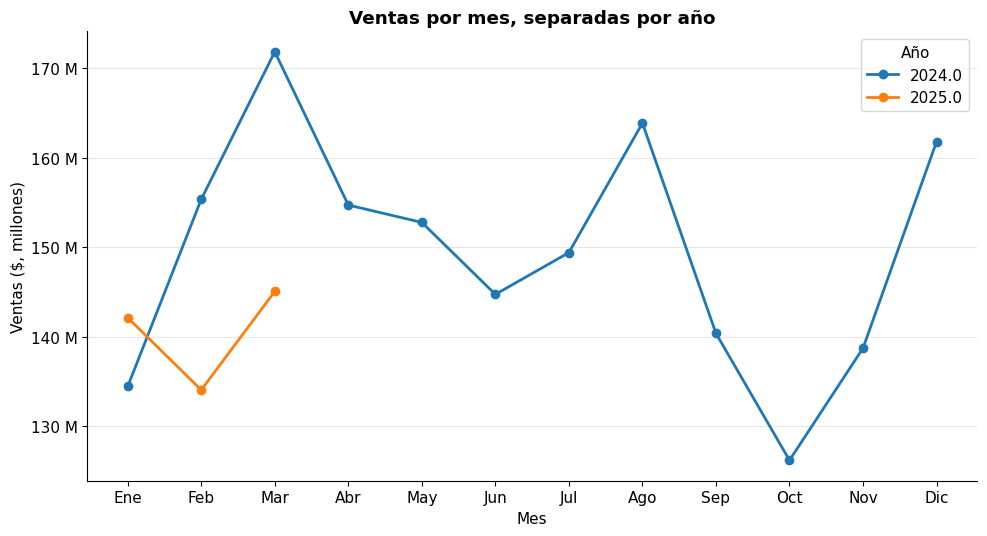
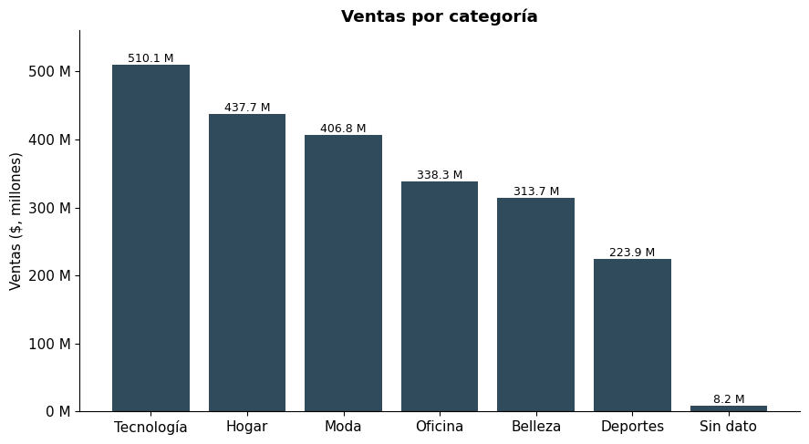
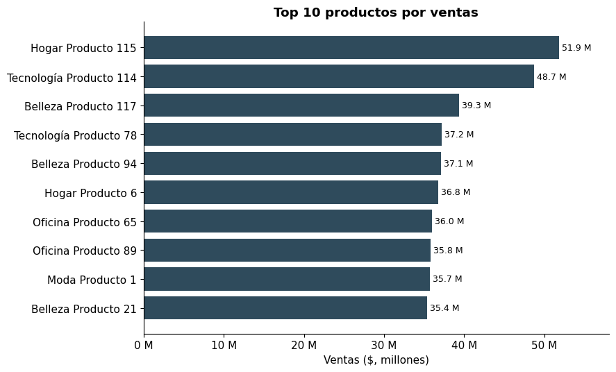
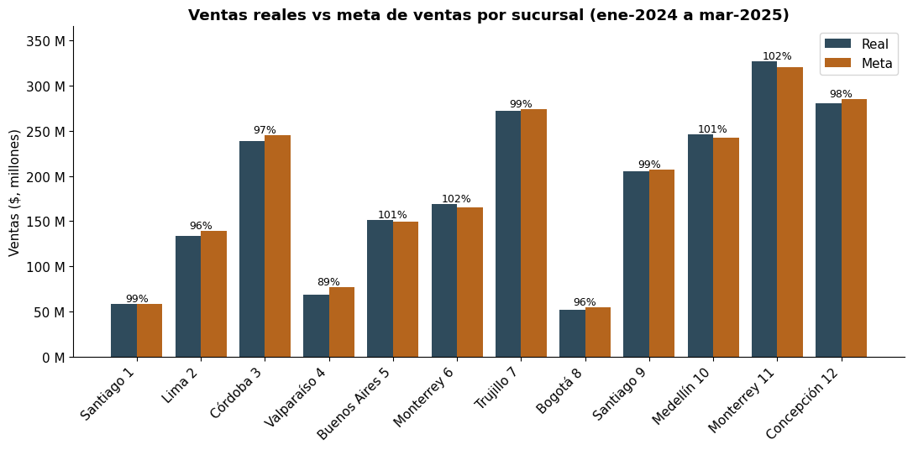

# Sistema de análisis comercial con Python

Proyecto final de Python (curso IPS DATAX): un flujo completo que carga 6 archivos Excel con errores reales, los limpia, los
unifica en una base analítica, calcula métricas y KPIs, mide el cumplimiento de metas, genera gráficos y exporta un reporte Excel.
Todo con **pandas** y **matplotlib**, en un cuaderno de Google Colab comentado paso a paso.

> **Datos ficticios.** Los datos pertenecen al material del curso y no se incluyen en el repositorio (ver [`data/`](data/README.md)).

## Qué hace el cuaderno

| Etapa | Qué hace |
|---|---|
| 1. Configuración | Rutas, parámetros de limpieza y funciones auxiliares documentadas |
| 2. Limpieza | Limpia los 6 archivos: ventas, clientes, productos, vendedores, sucursales y metas |
| 3. Unificación | Une las tablas por sus IDs sin perder ninguna venta y sin columnas duplicadas |
| 4. Transformación | Columnas de tiempo, venta bruta y neta, costo, utilidad y margen |
| 5. KPIs | Ventas, utilidad, margen, unidades, número de ventas, ticket y descuento promedio |
| 6. Tablas resumen | Por mes, categoría, país, canal, Top 10 productos y vendedores, utilidad por sucursal |
| 7. Metas | Ventas y unidades reales contra las metas de cada sucursal |
| 8. Gráficos | 8 gráficos guardados automáticamente en PNG |
| 9. Exportación | Reporte Excel con 10 hojas usando `pd.ExcelWriter` |

## Criterio de limpieza: reconstruir antes que borrar

La regla del proyecto fue no perder información innecesariamente. **Solo se eliminaron duplicados exactos**
(27 en ventas, 6 en clientes, 2 en productos y 2 en metas). Todo lo demás se corrigió, reconstruyó, imputó o estandarizó:

- **IDs inválidos** (`NO_EXISTE`, vacíos, `cli-0023`, `CLI0386`): se conservaron los válidos y se reconstruyeron los demás con el número que faltaba. En clientes y productos se usó el número del nombre.
- **Cantidades inválidas** (20 casos: texto, ceros, negativos, 999.999.999): se reconstruyeron desde el `Total_Venta` original. Las 20 dieron enteros exactos.
- **Precio de venta:** se reconstruyó con el precio de lista del producto (1.794 ventas); en 6 ventas sin producto válido se usó el precio original.
- **Descuentos:** solo valores entre 0 y 0,2; el resto pasa a 0 (12 casos). Textos como `20 %` se interpretan como porcentaje.
- **Metas inválidas** (vacías, negativas, cero o más de 5 veces la mediana de su sucursal): se reemplazaron por el promedio de los valores válidos de la misma sucursal.
- **Costos y precios de productos faltantes o exagerados:** se estimaron con la relación promedio costo/precio de los productos válidos (0,64).
- **Ventas sin producto** (6 ventas, $8,2 M): su costo se estimó con esa misma relación para que entren en la utilidad y el margen, y quedan marcadas con `Costo_Estimado = "Sí"`.
- **Fechas imposibles** (`31/02/2024`, `sin fecha`): quedan vacías, no se inventan.

## Resultados

| Indicador | Valor |
|---|---|
| Ventas totales | $2.238.550.180 |
| Utilidad total | $674.893.994 |
| Margen promedio | 29,50 % |
| Unidades vendidas | 8.071 |
| Número de ventas | 1.800 |
| Ticket promedio | $1.243.639 |
| Descuento promedio | 8,29 % |

**Hallazgos**

- **Categorías:** Tecnología lidera ($510 M), seguida de Hogar ($438 M) y Moda ($407 M). Deportes es la más baja ($224 M).
- **Países** (según el país del cliente): Perú lidera ($524 M); Colombia, Argentina y México están parejos entre $423 M y $443 M; Chile suma $397 M.
- **Canales:** muy equilibrados. Tienda ($578 M) y Distribuidor ($569 M) van arriba; Online y Marketplace rondan los $530–543 M.
- **Sin dependencia de un solo producto o vendedor:** el mejor producto aporta $52 M de $2.238 M y el mejor vendedor, $109 M.
- **Estacionalidad:** el mejor mes fue marzo de 2024 ($171,9 M) y el más bajo, octubre de 2024 ($126,2 M).
- **Cumplimiento de metas** (ene-2024 a mar-2025): entre 89 % y 102 % en ventas y entre 87 % y 103 % en unidades. Valparaíso 4 es la única sucursal bajo 90 % en ventas.
- **Para verificar:** Monterrey 11 es la sucursal con más utilidad ($97 M), pero figura como "Inactiva" en el archivo de sucursales y con la zona inválida. Puede ser un error de datos.

### Gráficos

Los 8 gráficos están en la carpeta [`img/`](img/).

## Decisiones de criterio y limitaciones

1. Los valores inválidos de texto pasan a "Sin dato" ("Sin nivel" en vendedores). Por eso aparecen barras "Sin dato" en algunos gráficos.
2. En "Ventas por país" se usa el país del cliente (se puede cambiar a país de la sucursal con un parámetro).
3. El cumplimiento de metas compara solo los meses con ventas (ene-2024 a mar-2025) y solo las ventas con sucursal y fecha conocidas.
4. 22 ventas sin fecha y 11 sin sucursal cuentan en los totales, pero no en el análisis mensual ni en las metas.
5. Los costos estimados con la relación promedio son aproximaciones. En las ventas sin producto, el margen queda determinado por el criterio (≈ 35,8 % sin descuento) y no aporta información nueva.
6. El margen promedio es el promedio simple de los márgenes por venta, no el margen ponderado.

## Cómo ejecutarlo

1. Abre [`notebook/Proyecto_Analisis_Comercial.ipynb`](notebook/Proyecto_Analisis_Comercial.ipynb) en Google Colab (Archivo → Subir cuaderno).
2. Sube los 6 archivos Excel al panel de archivos de Colab, en la carpeta `content` (ver [`data/`](data/README.md)).
3. Ejecuta las celdas en orden. Al final, la etapa 11 descarga los resultados en un `.zip`.

Si usas un runtime local, cambia `RUTA_PC` en la primera celda por la carpeta donde están los archivos.

## Tecnologías

Python · pandas · NumPy · matplotlib · openpyxl · Google Colab

## Autor

**Felipe Soto-Aguilar** · Analista de datos
[LinkedIn](https://www.linkedin.com/in/felipe-soto-aguilar/) · [GitHub](https://github.com/felipesotoaguilar)
